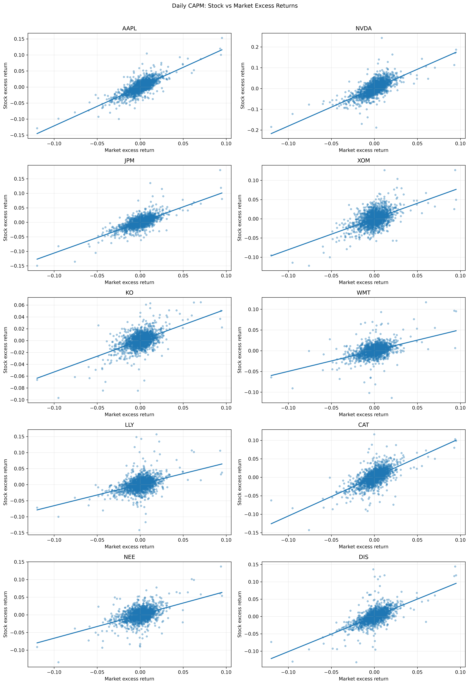
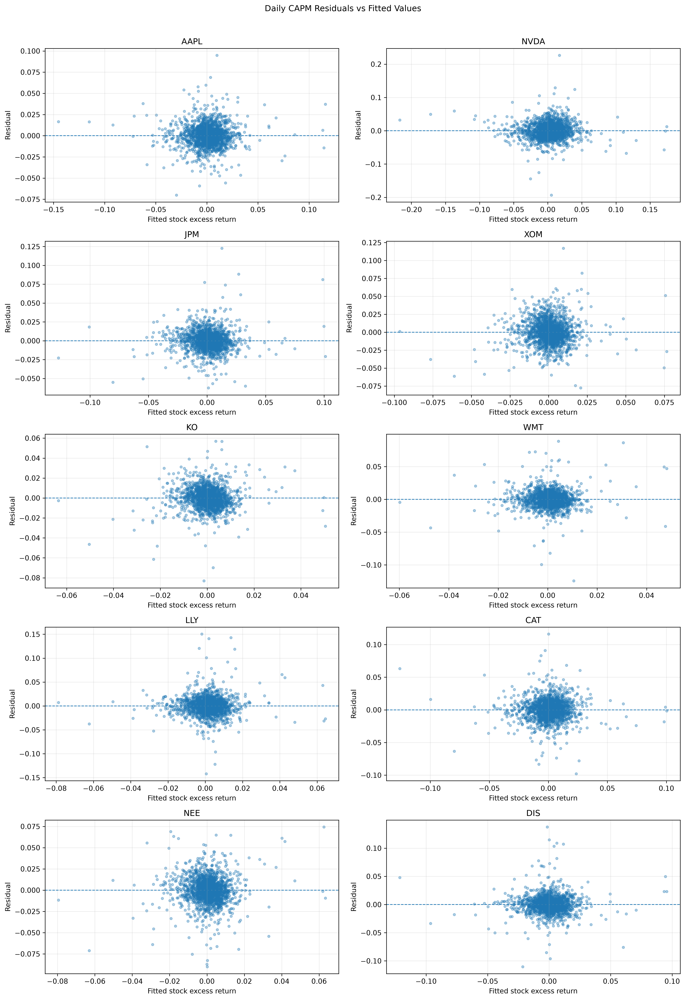
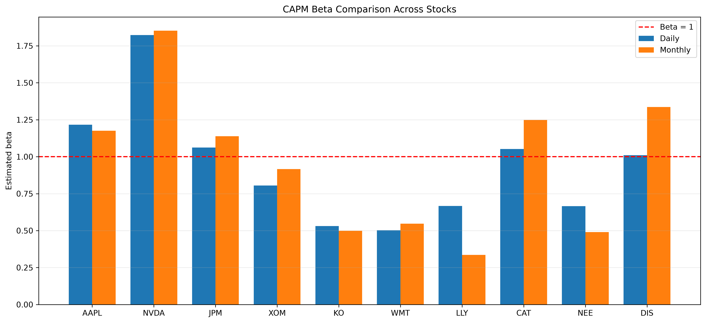
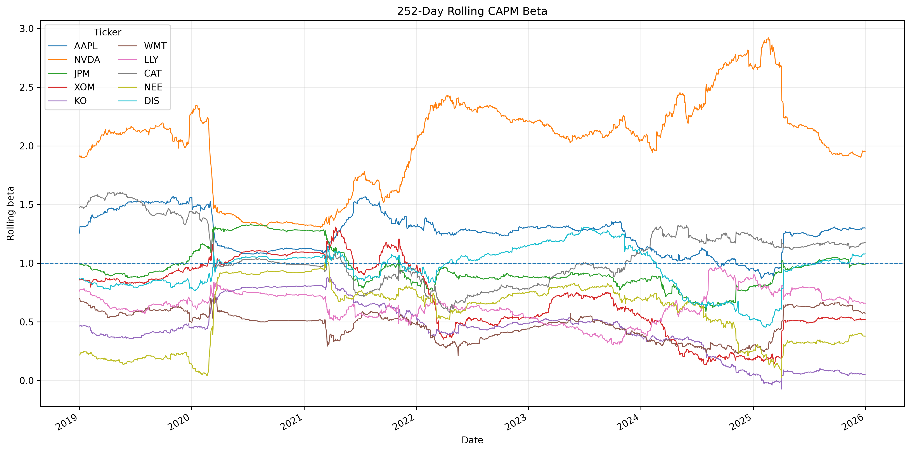

# CAPM Analysis of 10 U.S. Stocks

## Project Overview

This project applies the Capital Asset Pricing Model (CAPM) to analyse and compare the systematic market risk of 10 U.S. stocks across different industries.

Using historical market data from 2018 to 2025, the project estimates each stock's CAPM alpha, beta, R-squared, and statistical significance using Ordinary Least Squares (OLS) regression.

Both daily and monthly return frequencies are analysed to examine whether CAPM estimates are sensitive to data frequency. The project also includes residual diagnostics and a 252-day rolling beta analysis to investigate whether market exposure remains stable over time.

---

## Research Questions

The project addresses the following questions:

- Which stocks have beta above or below 1?
- Do relatively defensive stocks tend to have lower beta?
- Do any stocks exhibit statistically significant alpha?
- How much of each stock's excess-return variation is explained by market excess returns?
- Do daily and monthly CAPM estimates lead to different conclusions?
- Does beta remain stable over time?

---

## Stocks Analysed

The analysis includes 10 U.S. stocks from different industries:

| Company | Ticker | Sector / Industry |
|---|---|---|
| Apple | AAPL | Technology |
| NVIDIA | NVDA | Semiconductors / Technology |
| JPMorgan Chase | JPM | Financials |
| Exxon Mobil | XOM | Energy |
| Coca-Cola | KO | Consumer Staples |
| Walmart | WMT | Consumer Staples |
| Eli Lilly | LLY | Healthcare |
| Caterpillar | CAT | Industrials |
| NextEra Energy | NEE | Utilities |
| Disney | DIS | Communication Services / Entertainment |

The S&P 500 (`^GSPC`) is used as the proxy for the U.S. market portfolio.

---

## Data

### Sample Period

The main analysis covers:

**January 2018 – December 2025**

An additional month of data from December 2017 is downloaded as a buffer for calculating the first returns in the analysis period.

### Data Sources

- **Stock prices:** Yahoo Finance via `yfinance`
- **Market benchmark:** S&P 500 (`^GSPC`)
- **Risk-free rate:** 3-Month U.S. Treasury Bill Secondary Market Rate (`DTB3`) from FRED

### Sample Size

The final analysis contains approximately:

- **2,011 daily observations**
- **96 monthly observations**
- **10 individual stocks**
- **1 market benchmark**

Adjusted closing prices are used for return calculations.

---

## Methodology

### 1. Return Calculation

Simple returns are calculated from adjusted closing prices:

$$
R_t = \frac{P_t}{P_{t-1}} - 1
$$

Daily returns are calculated directly from consecutive trading-day prices.

Monthly returns are calculated using the last available adjusted closing price in each month.

---

### 2. Risk-Free Rate

The 3-Month U.S. Treasury Bill rate (`DTB3`) from FRED is used as a proxy for the risk-free rate.

Because the FRED series is reported as an annualised percentage rate, it is converted to decimal form and approximated as a daily risk-free return using 252 trading days per year.

$$
R_{f,daily}
\approx
\frac{R_{f,annual}}{252}
$$

Monthly risk-free returns are then constructed by compounding the daily risk-free returns within each month.

---

### 3. Excess Returns

CAPM is estimated using excess returns rather than raw returns.

For each stock:

$$
R_{i,t}^{e} = R_{i,t} - R_{f,t}
$$

For the market:

$$
R_{m,t}^{e} = R_{m,t} - R_{f,t}
$$

The stock, market, and risk-free-rate series are aligned by date before excess returns are calculated.

---

### 4. CAPM Regression

For each stock, the following CAPM regression is estimated using Ordinary Least Squares:

$$
R_{i,t} - R_{f,t}
=
\alpha_i
+
\beta_i(R_{m,t} - R_{f,t})
+
\epsilon_{i,t}
$$

where:

- $R_{i,t} - R_{f,t}$ is the stock excess return
- $R_{m,t} - R_{f,t}$ is the market excess return
- $\alpha_i$ is the CAPM alpha
- $\beta_i$ measures the stock's sensitivity to market excess returns
- $\epsilon_{i,t}$ is the regression residual

For each stock, the analysis reports:

- Alpha
- Alpha p-value
- Beta
- Beta p-value
- R-squared
- Number of observations

The CAPM is estimated separately using daily and monthly excess returns.

---

## Model Evaluation

The regression results are evaluated using both statistical and graphical methods.

The analysis includes:

- CAPM results tables
- Alpha and beta significance tests
- Daily vs monthly CAPM comparison
- Stock vs market excess-return scatter plots
- Fitted CAPM regression lines
- Residual diagnostics
- Cross-stock beta comparison
- 252-day rolling beta analysis
- Detailed in-sample OLS regression summaries

---

## Key Results

The analysis reveals substantial differences in systematic market exposure across the 10 stocks.

### Beta

NVIDIA has the highest estimated beta under both return frequencies:

- **NVDA daily beta:** approximately **1.82**
- **NVDA monthly beta:** approximately **1.85**

This indicates substantially greater sensitivity to market movements than a stock with a beta of one.

Apple also exhibits relatively high market sensitivity:

- **AAPL daily beta:** approximately **1.22**
- **AAPL monthly beta:** approximately **1.18**

In contrast, Coca-Cola and Walmart have beta estimates close to 0.5, indicating considerably lower sensitivity to market movements.

The results therefore show substantial cross-sectional differences in systematic market risk.

---

### Explanatory Power

The explanatory power of CAPM varies considerably across stocks.

For example:

- **AAPL daily R-squared:** approximately **0.60**
- **JPM daily R-squared:** approximately **0.51**
- **NVDA daily R-squared:** approximately **0.48**

An R-squared of approximately 0.60 for AAPL indicates that around 60% of the variation in its daily excess returns is associated with variation in market excess returns within the estimated model.

In contrast, some stocks have substantially lower R-squared values, indicating that a larger proportion of their return variation is not captured by the single market factor.

---

### Alpha and Statistical Significance

Most estimated alphas are not statistically significant at the 5% level.

However, **NVDA** and **LLY** show statistically significant positive alpha estimates in both the daily and monthly CAPM regressions.

Beta estimates are generally highly statistically significant, providing strong evidence that the selected stocks are exposed to systematic market risk.

---

### Daily vs Monthly Estimates

Daily and monthly CAPM estimates lead to broadly similar conclusions for several stocks, but meaningful differences are observed for some companies.

For example, some stocks exhibit noticeable differences in beta or R-squared when monthly rather than daily returns are used.

This suggests that CAPM estimates can be sensitive to return frequency.

---

## Key Visualisations

### Stock Excess Returns vs Market Excess Returns

Scatter plots are used to visualise the relationship between each stock's daily excess return and the market excess return.

The fitted CAPM regression line is included for each stock.



---

### Residual Analysis

Residual plots are used to examine the difference between actual stock excess returns and the values predicted by the CAPM regressions.

The residuals are generally centred around zero, although several stocks exhibit large residual observations and varying dispersion.



---

### Beta Comparison Across Stocks

Daily and monthly beta estimates are compared across the 10 stocks.

The horizontal reference line at beta equal to one helps distinguish stocks with relatively high and low market sensitivity.



---

### Rolling Beta

A 252-trading-day rolling window is used to investigate whether beta remains stable over time.

For each rolling window:

$$
\beta_{i,t}
=
\frac{
\operatorname{Cov}(R_i-R_f,\ R_m-R_f)
}{
\operatorname{Var}(R_m-R_f)
}
$$

The results show that beta changes meaningfully over time for several stocks.

NVDA maintains relatively high market sensitivity throughout much of the sample, while several other stocks move above or below a beta of one during different periods.

This suggests that full-sample beta should be interpreted as an average market exposure over the sample period rather than a permanently fixed measure of systematic risk.



---

## Example: Apple CAPM Regression

For AAPL, the daily CAPM regression produces approximately:

- **Beta:** 1.216
- **R-squared:** 0.599
- **Alpha:** 0.0005
- **Alpha p-value:** 0.065
- **Observations:** 2,011

The beta estimate indicates that AAPL's excess return is more sensitive to market movements than a stock with a beta of one.

The daily alpha is not statistically significant at the 5% level.

Using monthly data:

- **Beta:** approximately 1.176
- **R-squared:** approximately 0.459
- **Alpha:** approximately 0.011
- **Alpha p-value:** approximately 0.085
- **Observations:** 96

The daily and monthly specifications therefore lead to a broadly similar conclusion regarding AAPL's systematic market exposure.

---

## Main Findings

Overall, the project finds that:

1. Systematic market risk varies substantially across individual stocks.
2. NVDA has the highest estimated market sensitivity in the sample.
3. Relatively defensive stocks such as KO and WMT have substantially lower beta estimates.
4. Market excess returns explain substantially more return variation for some stocks than others.
5. Most stocks do not exhibit statistically significant alpha at the 5% level.
6. Daily and monthly return frequencies can produce different CAPM estimates.
7. Rolling beta analysis shows that market exposure changes over time.
8. CAPM is useful for measuring systematic market exposure but does not fully explain individual stock returns.

---

## Technologies Used

### Programming

- Python

### Libraries

- `pandas`
- `NumPy`
- `yfinance`
- `statsmodels`
- `Matplotlib`

### Tools

- Jupyter Notebook
- Visual Studio Code
- Yahoo Finance
- Federal Reserve Economic Data (FRED)

---

## Project Structure

```text
capm_project/
│
├── notebook/
│   └── capm_analysis.ipynb
│
├── output/
│   ├── beta_comparison.png
│   ├── regression_lines.png
│   ├── residuals_analysis.png
│   └── rolling_beta.png
│
├── data/
├── README.md
└── requirements.txt
```

The market and risk-free-rate data are downloaded directly within the notebook, so the analysis can be reproduced without storing the raw datasets locally.

---

## How to Run

### 1. Clone or download the repository

Open the project folder in Visual Studio Code or another Python development environment.

### 2. Create a virtual environment

```bash
python -m venv .venv
```

### 3. Activate the virtual environment

On Windows PowerShell:

```powershell
.\.venv\Scripts\Activate.ps1
```

### 4. Install dependencies

```bash
pip install -r requirements.txt
```

### 5. Open the notebook

Open:

```text
notebook/capm_analysis.ipynb
```

### 6. Run the notebook

Run the notebook cells in order.

The notebook automatically downloads:

- historical stock prices from Yahoo Finance;
- S&P 500 market data; and
- the 3-Month U.S. Treasury Bill rate from FRED.

---

## Limitations

This analysis has several limitations.

First, CAPM is a single-factor model and assumes that market exposure is the primary systematic driver of expected excess returns. Individual stock returns may also be influenced by company-specific events, industry conditions, size, value, momentum, and other risk factors.

Second, the estimated results depend on the selected sample period and return frequency. The differences between daily and monthly estimates demonstrate that parameter estimates can be sensitive to data frequency.

Third, the risk-free-rate conversion uses an approximation based on 252 trading days per year.

Finally, the rolling beta results show that beta is not constant over time, which limits the interpretation of a single full-sample beta as a permanent measure of market exposure.

---

## Possible Extensions

Future extensions of the project could include:

- comparing CAPM estimates across different market periods;
- analysing specific crisis or high-volatility periods;
- testing alternative rolling-beta window lengths;
- using alternative market benchmarks;
- comparing different risk-free-rate assumptions;
- constructing and analysing portfolios rather than individual stocks;
- extending the analysis to the Fama-French Three-Factor or Five-Factor models;
- evaluating CAPM performance using out-of-sample data.

---

## Author

**Rui Ni**

Individual project developed as part of a personal portfolio in quantitative finance, financial data analysis, and statistical modelling.